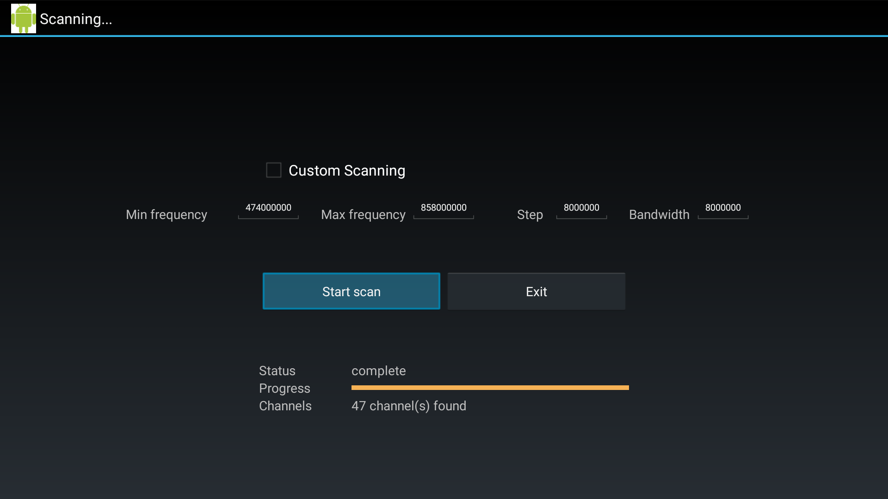
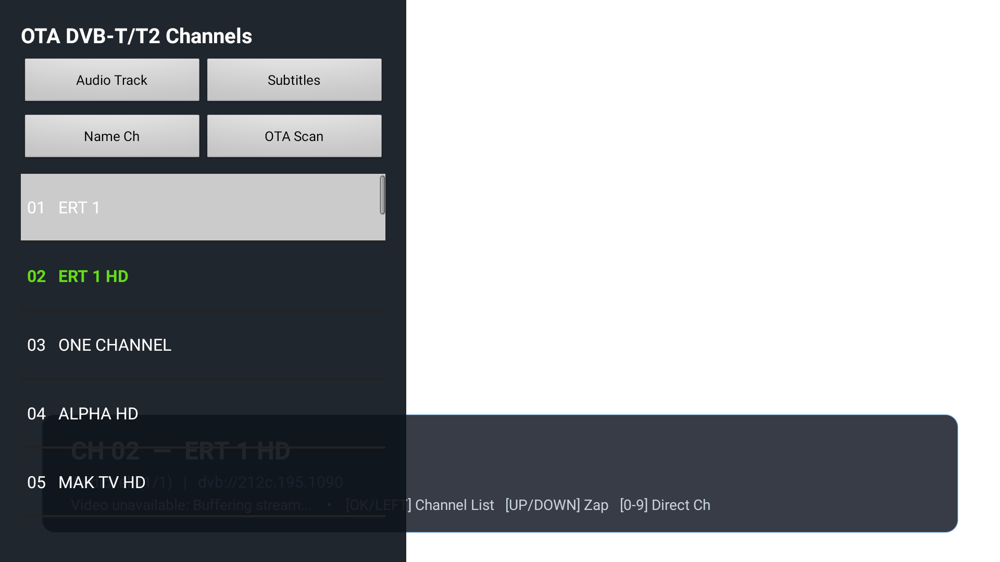

# Watching Live Over-The-Air TV on the Wind Vision Box

If you used to be a Wind (now Nova) subscriber in Greece, you might still have a **Wind Vision** Android TV box sitting in a drawer. The hardware itself—a **Technicolor DSI724HN** (codename *Pearl*)—is actually quite decent: an Amlogic S905D quad-core processor, 2 GB RAM, 8 GB storage, and a built-in DVB-T/T2 tuner for an over-the-air antenna.

I wanted to use the box as a simple TV receiver for free broadcast channels (ERT, Digea, regional channels) without paying for a subscription. But out of the box, getting live broadcast TV to work turned out to be tricky. Here is what I ran into and how I got it working.

## The Problem with Google Live Channels & Mochi Live TV

On Android TV, live channels usually go through the Android TV Input Framework (TIF). Hardware tuners register a `TvInputService`, scan for channels, and insert them into Android's shared database (`TvProvider`). Standard apps like Google Live Channels or the open-source Mochi Live TV app then read that database and display the channel guide.

On the Wind Vision box, you can run the tuner setup and scan for antenna channels. It finds all the local multiplexes (around 47 channels in Attica):



The problem comes right after exiting the scanner. Both Google Live Channels and Mochi show:

> **"No channels available"**

No results via adb either:

```bash
adb shell content query --uri content://android.media.tv/channel
# Output: No result found.
```

On Android 9 on this box, `TvProvider` enforces strict caller isolation. Only system apps or the specific app that created the rows (`com.technicolor.android.dtvinput`) are allowed to query the channels table. Even granting `READ_EPG_DATA` doesn't help. Because Google Live Channels can't read the rows, it assumes there are no channels and gives up.

And because the bootloader on this box has fused security flags, rooting it or flashing a custom ROM isn't really an option.

## The Workaround

While third-party apps can't *read* the channel rows from `TvProvider`, you can still tune to them:

```java
mTvView.tune(DTV_INPUT_ID, Uri.parse("content://android.media.tv/channel/" + channelId));
```

When you call `tune()`, Android just hands the URI down to Technicolor's input service. Since Technicolor's service runs with system privileges, it looks up the ID in its own database, locks onto the frequency, and starts hardware video decoding (`OMX.amlogic.avc.decoder.awesome`). The video and audio play fine.

So all we needed was a small app to hold a list of channel IDs and tune them directly.

### Mapping Channel Names

Tuning by raw numbers (603, 604, etc.) works, but having actual names makes it usable.

With `READ_LOGS` permission granted via ADB, the app can read system logcat. When a channel starts playing, the streamer logs the DVB service triplet:

```log
DTVFS::Open:168 path=/live/dvb:212c.195.1090/media.ts
```

In Greece, all over-the-air digital channels broadcast under network ID `212c` with standardized multiplex (`TSID`) and service IDs (`SID`). For instance:
- `212c.195.1090` is ERT 1 HD
- `212c.65.44c` is ALPHA HD
- `212c.67.640` is MEGA HD
- `212c.197.1108` is Vouli TV

Also, Technicolor's EPG service logs the broadcast channel names as it updates programs:

```log
DtvSetup: Update(DtvTerrestrialSetup): (4-ERT 3 HD) programs updated
```

By keeping a lookup table of Greek DVB triplets and reading these logs, the app automatically matches channel IDs to their proper names.

## The App: `vision-revive-tv`

I put together a simple, remote-friendly Android TV app to wrap this up:



- **Channel list**: Press `OK` or `Left` to open a side panel with the channel list.
- **Zapping**: Use `Up`/`Down` or `CH+`/`CH-` on the remote to flip through channels.
- **Info banner**: Shows the channel number, station name, resolution (1080p / 576i), and audio track, then hides after a few seconds.
- **Number keys**: Type numbers on the remote (e.g. `0` `4`) to tune directly.
- **Audio & subtitles**: Buttons on the side panel to cycle audio languages or toggle DVB subtitles.
- **Auto-probe**: An option in the menu to scan through channel IDs if you do a fresh antenna scan.

## How to Set It Up

If you want to try this on your Wind Vision box:

### 1. Enable ADB

1. Go to **Settings** $\rightarrow$ **Device Preferences** $\rightarrow$ **About**.
2. Click **Build** 7 times to enable Developer options.
3. In **Developer options**, enable **USB debugging** / **Network debugging**.
4. Check your box's IP address under **Settings** $\rightarrow$ **Network & Internet**.

### 2. Install the App via ADB

From a computer on the same local network:

```bash
# Connect to the box
adb connect <box-ip>:5555

# Download the latest APK from GitHub Releases:
# https://github.com/hypest/vision-revive-tv/releases/latest
adb install -r vision-revive-tv-*.apk

# Grant log read permission for channel name detection
adb shell pm grant org.hypest.visionrevivetv android.permission.READ_LOGS
```

### 3. Scan Channels

1. Open the app (`Vision Revive TV`) from your launcher, or run:
   ```bash
   adb shell am start -n org.hypest.visionrevivetv/.MainActivity
   ```
2. Press `OK` to open the side panel, select **OTA Scan**, and launch the Technicolor scanner.
3. Once the scan finishes, press `BACK` to return to the app.
4. Select **Auto-Detect Active Channels** from the scan menu to load the newly scanned range.

The app will tune the channels and resolve their names.

---

The code and releases are available on GitHub: [github.com/hypest/vision-revive-tv](https://github.com/hypest/vision-revive-tv).

If you give it a try on your box, let me know how it goes!

---

*Disclaimer: Wind, Wind Vision, Nova, and Technicolor are trademarks of their respective owners. This project is an independent open-source effort for hardware interoperability and is not affiliated with, endorsed by, or sponsored by Wind Hellas, Nova, Technicolor, or their affiliates.*

